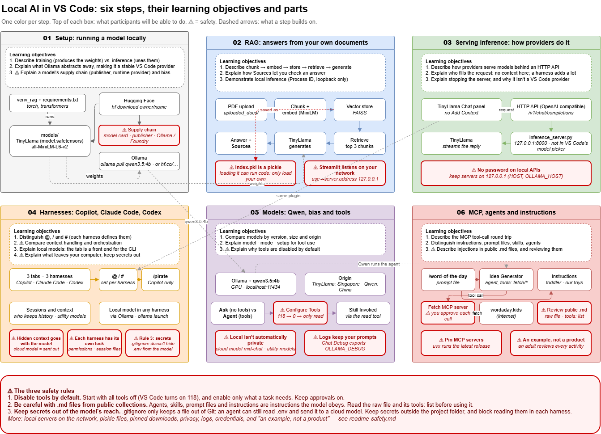

# Learning Objectives and Demo Plan

This is the plan for presenting the project in six steps, **01 to 06**, matching the numbered
guides. Each step has **at most three learning objectives** (four in step 04, which adds safety rule 3)
and **a demonstration of about 8 to 13 minutes**. The times are recommendations, not limits: with an introduction and questions, plan
for a little over an hour. Each objective completes the sentence
**"After this step, participants will be able to …"**.

The diagram below shows each step, its learning objectives and its parts, one color per step:
**01 gray, 02 blue, 03 green, 04 orange, 05 purple, 06 red.** Safety points are marked ⚠ in red
boxes. To edit it, open [docs/learning-steps.drawio](docs/learning-steps.drawio) in draw.io.



## Pre-flight checklist

Do these in order, about 15–20 minutes before presenting. The times in each step are
**recommendations**, not limits.

**Computer and screen**
- [ ] Close apps you won't show, so the GPU and memory are free. Plug in the laptop.
- [ ] On Zoom, share your **entire screen**, not one window: the demo moves between VS Code, a
      second VS Code window, a browser, Resource Monitor and terminals.
- [ ] Raise the font size in VS Code (`Ctrl+=`) and in the terminals, so the audience can read them.
- [ ] All work committed (`git status` is clean). Steps 03–04 switch to an older commit.

**Step 01–02 (TinyLlama, RAG)**
- [ ] `.\venv_rag\Scripts\Activate.ps1` in a terminal.
- [ ] Start the Envie app once (`streamlit run src/main.py`), so its models are loaded. Leave it
      running. Have the lecture PDF ready to upload.
- [ ] Open Resource Monitor (`resmon`) on the **Network** tab.
- [ ] Browser tab open on [TinyLlama's model card](https://huggingface.co/TinyLlama/TinyLlama-1.1B-Chat-v1.0).

**Step 03–04 (TinyLlama through the plugin): switch to the TinyLlama commit**

From step 05 on, the test window's settings point the plugin at Qwen in Ollama. For steps 03–04,
use commit **`378b56c` ("feat: harness")**, where the plugin still uses TinyLlama through
`src/inference_server.py`:
```powershell
git switch --detach 378b56c
```
- [ ] Start the server: `python src/inference_server.py` (in its own terminal, so you can show its log).
- [ ] **Terminal → Run Task… → Run TinyLlama Plugin**, to open the Extension Development Host.
- [ ] In that window: a **new chat**, session **Local**, mode **Ask**.
- [ ] In your **main** VS Code window (not the test window, which has extensions turned off): the
      **Claude Code** and **Codex** extensions installed and signed in, so their tabs work in step 04.
- [ ] For step 04's local Claude Code: Ollama running with `OLLAMA_CONTEXT_LENGTH` raised (e.g.
      `32768`), and `ollama launch claude` tried once with `qwen3.5:4b`, so nothing installs live.
- [ ] For step 04's rule 3 demo: **no** real `.env` anywhere in the project; the deny rule ready to
      paste; a screenshot of the refusal as a backup.

After step 04, go back to the latest version **before** step 05:
```powershell
git switch main
```
Then close the Extension Development Host window. You can stop `inference_server.py` too, as it's
not used after step 04.

`git switch` only works when nothing is uncommitted, so commit everything before the presentation.
Models, `uploaded_docs/` and `vectorstore/` aren't in git, so they stay as they are.

**This plan isn't in that older commit,** nor are steps 05–06's files, so they disappear from VS Code
until you switch back. Keep this plan open somewhere else during steps 03–04: on GitHub after you
push, in a browser, or printed.

**Step 05 (Qwen in Ollama)**
- [ ] Ollama running (tray icon), with the context window set (`OLLAMA_CONTEXT_LENGTH`).
- [ ] Warm up: `ollama run qwen3.5:4b "hi"`, then `ollama ps` shows `100% GPU`.
- [ ] `qwen3.5:4b` added to Copilot's model picker (Ollama extension).
- [ ] **Configure Tools still shows all tools selected,** so you can turn them off live. Step 05
      shows the default and then turns everything off except **read**.

**Step 06 (MCP, agents, instructions)**
- [ ] Fetch server started once before the presentation (the first start downloads it).
- [ ] Today's word checked on [wordaday.kids](https://wordaday.kids/word-of-the-day-for-kids/).
- [ ] `.github/instructions/our-toys.instructions.md` edited to your real toys.

**Backup plan**
- [ ] A screenshot or short recording of each step's key moment, in case a live demo misbehaves,
      e.g. `docs/images/toddler-word-activity.png` for step 06.

---

## The safety thread

Safety is one of the most important parts of the presentation. It builds up across the steps, and
participants should leave able to explain these three rules:

1. **⚠ Disable tools by default.** In Agent mode, VS Code turns on every tool, 118 on this
   computer: editing files, running terminal commands, fetching web pages, acting on GitHub. A
   model, even a local one, can be confused or manipulated into misusing them. Start with all tools
   off, and enable only what a task needs. *(Steps 05 and 06)*
2. **⚠ Be careful with `.md` files from public collections.** Agents, skills, prompt files and
   instructions files are plain Markdown that the model **follows as instructions**. One installed
   from a public collection, a marketplace or a cloned repository can hide injected instructions,
   or grant itself broad tools. Read the raw file and its `tools:` list before using it. *(Steps 04,
   05 and 06)*
3. **⚠ Keep secrets out of the model's reach.** `.gitignore` only keeps a file out of Git, not out
   of the model's context. An agent can read `.env` with its tools, often without asking, and send
   it to a cloud model; a cloud agent takes everything committed. Keep secrets outside the project
   folder, block reading them in each harness, and don't attach or open them while chatting.
   *(Step 04)*

Supporting points along the way:
- "Local" protects your data from the model's maker. It doesn't limit what **tools** can do on your
  computer. *(Step 05)*
- ⚠ Fine-tuning (QLoRA) makes it cheap to add bias to a model, and anyone can publish one, so the
  publisher matters. *(Steps 01 and 05)*
- ⚠ A pickle file like `vectorstore/index.pkl` can run code when loaded: never load one you didn't
  create. *(Step 02)*
- ⚠ This is an example project, not a product: an adult reviews every generated activity before
  it's used with children. *(Step 06)*

All safety and security points, including local servers on the network, pinning downloads,
privacy, logs and credentials, are collected in [readme-safety.md](readme-safety.md).

---

## Step 01 – Setup: what it takes to run a model locally (10 minutes)

Guide: [01_readme-setup.md](01_readme-setup.md)

**Learning objectives:**
1. **Describe** the difference between the two stages of a model's life:
   - **training**, done once by the model's makers at great cost, which **produces the weights**:
     a file of learned numbers such as `model.safetensors`;
   - **inference**, done every time you ask a question, which **uses those fixed weights** to
     generate an answer, and doesn't change them.

   Running a model locally means doing **inference** on your own computer. That needs the
   weights, plus a Python environment with libraries (`torch`, `transformers`) to run them.
2. **Explain** how **Ollama** hides the complexity of serving inference, compared with
   **downloading `model.safetensors` yourself** from Hugging Face. Done yourself, your own code
   loads the weights and tokenizer, applies the chat format, chooses CPU or GPU, runs the separate
   **embedding model** (here, `all-MiniLM-L6-v2` for RAG), and needs its own server to share the
   model with other programs. Ollama does all of that from one `ollama pull`, from its own library
   or straight from Hugging Face (`ollama pull hf.co/<owner>/<repository>`): it downloads a
   compressed copy, runs it on the GPU, loads and unloads it as needed, and serves both chat and
   embedding models through one API. Because of that abstraction, Ollama is a **stable provider for
   VS Code**: Copilot talks to one well-known API, with the same model names, however the model is
   stored or run underneath ([01_readme-setup.md](01_readme-setup.md), "Downloading the model
   yourself vs. using Ollama").
3. ⚠ **Explain** the **supply chain** of a downloaded model: it can carry **bias** from its training
   data and fine-tuning ([readme-model-training.md](readme-model-training.md)), so the publisher and
   the model card matter. A runtime like **Ollama** (Ollama Inc.) or **Foundry Local** (Microsoft)
   takes over much of that supply chain, choosing, converting and serving the models, so you're
   trusting the runtime provider as well as the model's maker.

**Demonstration:**
| Time | What you do | What to point out |
|---|---|---|
| 2 min | Show the `models/` folder in the Explorer: `TinyLlama/` and `all-MiniLM-L6-v2/`. Open `config.json`. | `model.safetensors` (2.1 GB) *is* the model; everything else is settings and the tokenizer. |
| 2 min | Show `requirements.txt` and the activated `venv_rag`. | The libraries (`torch`, `transformers`) are the "engine" that runs the weights, through our own code (`src/main.py`). |
| 3 min | Side by side: the download command `hf download TinyLlama/TinyLlama-1.1B-Chat-v1.0 --local-dir models/TinyLlama`, and in a terminal `ollama list` and `ollama show qwen3.5:4b`. Then show the comparison table in [01_readme-setup.md](01_readme-setup.md). | **Yourself:** the original weights in the project's `models/` folder; your code loads and runs them. **Ollama:** a compressed copy (`quantization Q4_K_M`) in Ollama's own folder; Ollama runs it on the GPU and serves an API, with no code. |
| 3 min | ⚠ Open the model card for [TinyLlama on Hugging Face](https://huggingface.co/TinyLlama/TinyLlama-1.1B-Chat-v1.0): its publisher, license and training datasets. Then show "What LoRA and QLoRA are" in [readme-model-training.md](readme-model-training.md). | Everything the model "believes" comes from its training data. A few hundred QLoRA examples on a home GPU can add a bias, and anyone can publish the result, so check who published a model and what it was trained on. |

**Prepare beforehand:** venv activated; nothing downloading live. Downloads take minutes.

---

## Step 02 – RAG: answering from your own documents (10 minutes)

Guide: [02_readme-rag-user-guide.md](02_readme-rag-user-guide.md)

**Learning objectives:**
1. **Describe** the steps of retrieval-augmented generation: split documents into **chunks**, turn
   them into **embeddings** (vectors), store them in a **vector store**, **retrieve** the closest
   chunks for a question, and **generate** an answer from them.
2. **Explain** how showing the **sources** (document, page, exact text) lets you check whether an
   answer came from the document.
3. **Demonstrate** that the model runs locally, using the app's Process ID and its network
   connections.

**Demonstration:**
| Time | What you do | What to point out |
|---|---|---|
| 2 min | `streamlit run src/main.py`; show the heading: Process ID, model, Location. | The model is loaded from `models/TinyLlama` on this computer. |
| 2 min | Upload the lecture PDF and wait for *"Vector store created and saved."* | Chunking and embedding happen here, once. |
| 3 min | Ask *"What is the inverse of a queue?"*, then open **Sources**. | Retrieval found page 22; the answer is built from that text. |
| 3 min | Resource Monitor → Network → filter by the Process ID. | Only loopback (`127.0.0.1`) connections: nothing leaves the computer. |

**Prepare beforehand:** the app started once, so the models are loaded. Question rehearsed;
TinyLlama is inconsistent.

---

## Step 03 – Serving inference: how model providers do it, in miniature (8 minutes)

Guides: [03_readme-plugin-startup.md](03_readme-plugin-startup.md) and the server,
[src/inference_server.py](src/inference_server.py)

**Learning objectives:**
1. **Describe** how frontier model providers serve inference: the model runs on their servers
   behind an **HTTP API**. A client sends a list of messages, and the reply streams back piece by
   piece. `src/inference_server.py` does the same on this computer, using the same
   **OpenAI-compatible** request format.
2. **Explain** that a model only knows what's in the request it receives, and who fills that
   request. A plain chat client like the TinyLlama Chat panel sends only your typed text: it has
   **no way to add context** (files, the open editor, the project). A harness such as Copilot,
   built on the Copilot SDK, adds context **from many places**: its own system instructions, tool
   definitions, workspace details, the skills list, instructions files, history and attachments.
   That can fill a small model's **context window** before your question is even counted (about
   9,000 tokens for "Hello?" here).
3. **Explain** what stopping the server proves about where the answers come from, and why a local
   model isn't automatically usable everywhere in VS Code. The answers stop because they come only
   from this program on this computer. But `src/inference_server.py` isn't a **supported model
   provider**: it doesn't appear in Copilot's model picker, and only our own plugin (the panel and
   `@tinyllama`) can reach it. Ollama and Foundry Local appear there because each has a provider
   extension. The Ollama extension, for example, registers through VS Code's **Language Model Chat
   Provider** API. Because [VS Code is open source](https://github.com/microsoft/vscode), our server
   could be added the same way, by writing a provider extension that forwards Copilot's requests to
   it. That's out of scope here, and rarely needed: the **Copilot SDK harness** gives any supported
   model, including local ones served by Ollama or Foundry Local, the same common tools, skills and
   agents. So the practical route for a local model is to serve it through a supported provider,
   not to build a new one.

**Demonstration:**
| Time | What you do | What to point out |
|---|---|---|
| 2 min | Terminal: `python src/inference_server.py`. Open <http://127.0.0.1:8000/v1/models> in a browser. | A "model provider" on your own computer: an address, a model list, the same API shape as the big providers' services. |
| 2 min | **Terminal → Run Task… → Run TinyLlama Plugin**, then `Ctrl+Shift+P` → **TinyLlama: Open Chat**. Ask *"What is a stack?"* with the server terminal side by side. | A `Request:` line appears, and the answer streams in: one HTTP request, one streamed response. |
| 2 min | Point at the panel: a text box and Send / Stop / Clear, but **no Add Context, no paperclip, no `#`**. Ask *"What's in readme.md?"*, and point at the server log's prompt size: a few hundred tokens. | It can't know: nothing but your typed text is sent. The opposite extreme: Copilot's harness adds about 9,000 tokens of its own context to "Hello?" (shown in step 05's Chat Debug View), more than TinyLlama's whole 2,048-token window. |
| 2 min | `Ctrl+C` the server, ask again; restart it, ask again. Then open Copilot Chat's model picker. | *"Couldn't reach the TinyLlama server"*: the answers come only from this program. TinyLlama isn't in the model picker: our server isn't a supported provider, while Ollama's models are (step 05). |

**Prepare beforehand:** switch to the TinyLlama commit, `git switch --detach 378b56c` (see the
pre-flight checklist), so the plugin uses TinyLlama through `src/inference_server.py`. Start the
server once (model loading takes 10–30 seconds).

---

## Step 04 – Harnesses: Copilot, Claude Code and Codex, and what they do with context (13 minutes)

Guides: [04_readme-harness.md](04_readme-harness.md) (sections 7 and 8),
[readme-sessions.md](readme-sessions.md), and section 11 of [readme-safety.md](readme-safety.md)

**Learning objectives:**
1. **Distinguish** what the `@`, `/` and `#` operators do, and **recognize** that each **harness**
   defines them. In Copilot's Chat tab, `@` picks *who* answers (a chat participant, `@tinyllama`),
   `/` picks *what to do* (a skill or prompt file, `/pirate`) and `#` adds context or a tool. In
   Claude Code and Codex, `@` attaches a file, `#` means nothing, and Codex uses `$` for skills.
   Copilot, Claude Code and Codex are three separate harnesses from three companies, each reading
   its own folders.
2. **Compare** how harnesses handle context and **orchestrate agents**: who keeps the history
   (sessions, and where they're saved), what happens when the context window fills up, which
   **utility models** see the conversation, which tools are offered, ⚠ each harness's own
   permission settings, and how agents work together in each: **handoffs** (Copilot only,
   `handoffs:` in `.agent.md`), **subagents** (all three) and **teams** (experimental in Claude
   Code and Codex). Handoffs don't carry over between harnesses.
3. **Explain** how each harness can run a **local model** like Qwen. Each harness is a program on
   your computer, separate from the model: Claude Code's
   `%USERPROFILE%\.vscode\extensions\anthropic.claude-code-<version>-<platform>\resources\native-binary\claude.exe`,
   Codex's `%USERPROFILE%\.vscode\extensions\openai.chatgpt-<version>-<platform>\bin\<platform>\codex.exe`,
   and, for Copilot, a Node.js package inside VS Code's built-in Copilot extension. The **VS Code
   tab is a front end for the CLI**: it starts that program and passes messages to it as JSON, so
   the CLI and the tab connect to a local model the same way (Claude Code: `ollama launch claude`
   or `ANTHROPIC_BASE_URL`; Codex: `codex --oss` or `config.toml`; Copilot: the model picker, or
   `ollama launch copilot` for the CLI).
4. ⚠ **Explain what leaves your computer, and how to keep secrets out of it** (safety rule 3).
   Each harness sends **hidden context** with every message (system prompt, tools, instruction
   files, skills list, environment), which goes wherever the model runs. A `.env` file isn't sent
   on its own, but **`.gitignore` doesn't keep it out of the model's context**: an agent can read
   it with its tools, often without asking, and a cloud agent takes everything committed. Keep
   secrets outside the project folder, block reading them in each harness (e.g. Claude Code's
   `permissions.deny`), and don't attach or open them while chatting.

**Demonstration:**
| Time | What you do | What to point out |
|---|---|---|
| 2 min | In the Extension Development Host (commit `378b56c`): Chat view → **new chat** → **Local** → **Ask**. Ask `@tinyllama /pirate what is a stack?` Then ⚠ open `.github/skills/pirate/SKILL.md` raw. | `@` = who answers, `/` = what to do: our plugin adds `@tinyllama`, VS Code's harness finds `/pirate` in `.github/skills/`. A skill is Markdown the model obeys (rule 2). |
| 2 min | In your **main** VS Code window, type `@`, `/` and `#` in the **Chat**, **Claude Code** and **Codex** tabs. Show the operators table (04, section 7). | The same keys mean different things in each tab: `@` is a participant in one and a file in the others. `/pirate` only appears in the Chat tab, because only Copilot reads `.github/skills/`. Three harnesses, three sets of folders. |
| 3 min | Side by side: `@tinyllama` in the Chat view (left) and **TinyLlama: Open Chat** (right). Ask both *"What was my first message?"*, then **New Session** / **Clear** and ask again. Show the **Sessions** list. | The model remembers nothing: each program keeps the history and resends it. VS Code saves sessions to disk; our panel only in memory. The session title came from a **utility model**. Show the context table (readme-sessions, section 2), then the orchestration table (04, section 7): handoffs are Copilot-only buttons; all three have subagents. |
| 3 min | Show the program behind the Claude Code tab: `claude.exe` in the extension's `resources\native-binary\` folder. In a terminal, run `ollama launch claude` and choose `qwen3.5:4b`; press **Shift+Tab** out of auto mode. Then show the hidden-context table (04, section 8). | The tab is a front end for the CLI: the same program, so the same way to connect a local model. Claude Code now runs on your GPU, and warns it doesn't know Qwen's context size. Its hidden prompt is large; Copilot's is about 9,000 tokens for "Hello?". |
| 3 min | ⚠ Rule 3, live and safely: create a dummy `.env` containing `DEMO_TOKEN=not-a-real-secret`. In the Claude Code terminal on Qwen, ask *"What settings does this project use?"* Then add the deny rule to `.claude/settings.json`, restart Claude Code, and ask again. Delete the dummy `.env` afterwards. | `.env` is in `.gitignore`, yet the agent can read it, probably without asking. With a cloud model, the token would now be with the vendor. After the deny rule, the read is refused. Each harness has its own lock: name Copilot's **Configure Tools**, Claude Code's permission modes and deny rules, and Codex's `sandbox_mode`. |

**Prepare beforehand:** the Extension Development Host on commit `378b56c` with the inference
server running (see the pre-flight checklist); your **main** VS Code window with the Claude Code
and Codex extensions installed and signed in; [readme-sessions.md](readme-sessions.md) and section 8
of [04_readme-harness.md](04_readme-harness.md) open for the tables. For the rule 3 demo, use only
the dummy token and the **local** model, and rehearse it: a small model may not read `.env` every
time, so have the deny rule's refusal ready as a screenshot. Why small models can't use Agent mode
is covered in step 05.

**Afterwards:** `git switch main`, and close the Extension Development Host, before step 05.

---

## Step 05 – Models: a better local model, bias, and tools (10 minutes)

Guide: [05_readme-models.md](05_readme-models.md)

**Learning objectives:**
1. **Compare** TinyLlama 1.1B with Qwen 3.5 4B by **version** (training generation), **size**
   (parameters) and **origin** (Singapore, China).
2. **Explain** the three conditions for a model to use tools such as skills: the **model** can call
   tools, the **mode** provides tools (Agent, not Ask), and the **setup** fits (context window, GPU
   memory).
3. ⚠ **Explain** why every tool should be **disabled by default**: tools act on your computer and
   accounts, with your permissions, even when the model is local.

**Demonstration:**
| Time | What you do | What to point out |
|---|---|---|
| 2 min | `ollama run qwen3.5:4b "hi"`, then `ollama ps`. Show the "Where the models come from" table. | `100% GPU`; who made each model and where. Recall step 01: origin and training shape a model's behavior. |
| 2 min | ⚠ Copilot Chat → Agent mode → the tools button → **Configure Tools**. Show **118 Selected**, then untick everything (**0 Selected**) and tick only **read**. | VS Code's default is everything on. We start from nothing and add only what's needed. |
| 3 min | New Local chat, `qwen3.5:4b`, **Agent**. Ask *"What is a stack? Answer like a pirate."* without `/pirate`. | Look for *"Skill Invoked: pirate"*: the model chose the skill and called the **read** tool, the one tool we allowed. |
| 3 min | **Developer: Show Chat Debug View** → the request for a short question. | Thousands of tokens of hidden instructions and tool definitions. Each enabled tool is something the model could be talked into using. |

**Prepare beforehand:** the model warmed up; the context window set (`OLLAMA_CONTEXT_LENGTH`); Agent
mode rehearsed. It's the step most likely to misbehave.

---

## Step 06 – MCP, agents and instructions: the daily routine, safely (10 minutes)

Guide: [06_readme-mcp-agents.md](06_readme-mcp-agents.md)

**Learning objectives:**
1. **Describe** how **MCP** lets a local model use an external tool: VS Code starts the MCP server,
   the model asks for a tool call, you approve it, VS Code runs it, and the result goes back to the
   model.
2. **Distinguish** the four kinds of saved instructions by *when* they apply: **instructions files**
   (automatically, or when linked), **prompt files** (`/name`), **skills** (`/name` or chosen by the
   model) and **custom agents** (selected for the whole chat).
3. ⚠ **Describe** how `.md` files installed from public collections can carry **prompt
   injections**, and how to review them before use: read the raw file, check its `tools:` list,
   and keep tools off and approvals on.

**Demonstration:**
| Time | What you do | What to point out |
|---|---|---|
| 2 min | **MCP: List Servers** → **fetch** → **Start Server**; show its output (*"Discovered 1 tools"*). | The server is a separate program, configured in `.vscode/mcp.json`. |
| 2 min | ⚠ Open `.github/agents/simple-app-idea-generator.agent.md` (raw). Show the header: the source, the original 11 tools, now trimmed to `fetch/*`. Run the scan command from the guide. | A public agent, reviewed and cut down to the one tool it needs. Look for hidden comments, URLs and broad tool lists. |
| 4 min | New Local chat, `qwen3.5:4b`, type `/word-of-the-day`; read the fetch request, then **Allow** it. | One command brings in a prompt file, an agent, an MCP tool and two instructions files. Approving the call is your checkpoint. |
| 2 min | Show the toddler activity, then `word-of-the-day.prompt.md`, `toddler-friendly.instructions.md` and `our-toys.instructions.md`. | The model is local; the only internet access was the one fetch you approved. |

**Prepare beforehand:** the Fetch server started once (the first start downloads it); tools
already off in Configure Tools (from step 05); the toy list edited; today's word checked, as it
changes daily.

---

## Summary

| Step | Minutes | Learning objectives |
|---|---|---|
| 01 Setup | 10 | Describe training vs. inference · Explain what Ollama abstracts away · ⚠ Explain a model's supply chain and bias |
| 02 RAG | 10 | Describe the RAG steps · Explain sources · Demonstrate local inference |
| 03 Serving inference | 8 | Describe API serving · Explain who fills the request (no context vs. a harness's context) · Explain stopping the server, and supported providers |
| 04 Harnesses | 13 | Distinguish @, / and # per harness · ⚠ Compare context handling and orchestration · Explain local models and CLI vs. tab · ⚠ Explain what leaves your computer, and keeping secrets out |
| 05 Models | 10 | Compare models by version, size and origin · Explain tool conditions · ⚠ Explain tools off by default |
| 06 MCP and agents | 10 | Describe MCP · Distinguish instruction files · ⚠ Describe injections in public `.md` files |
| **Total** | **61** | 19 objectives |

**For a quick check of learning,** ask participants at the end of each step to explain one objective
to the person next to them in one minute. End with the three safety rules: they should be able to
state all three.
