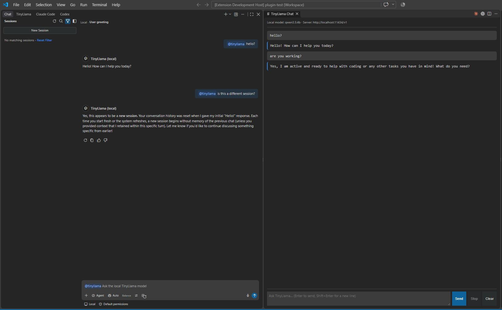
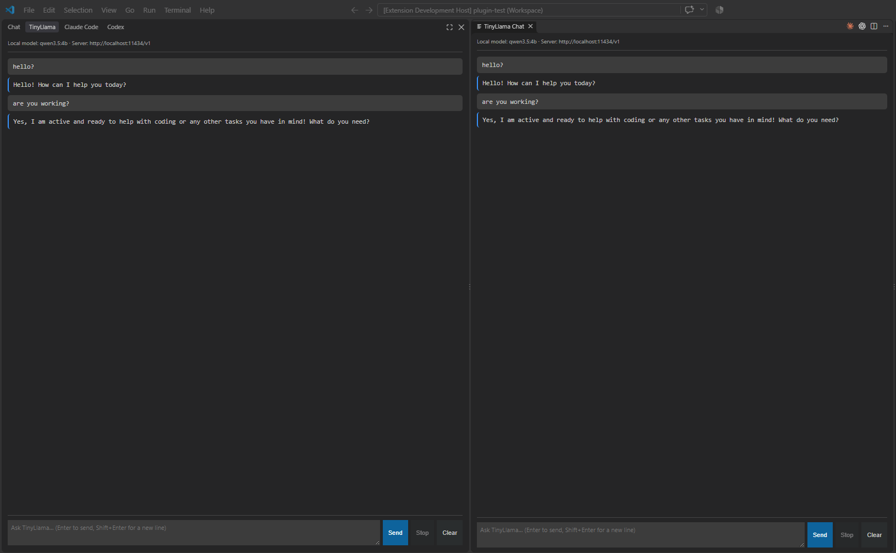

# Sessions: Who Remembers the Conversation?

A model remembers nothing between requests. Every request carries the **whole conversation**, so
"memory" depends on **which program keeps the history and sends it again** each time. This guide
compares the two ways this project chats with the same local model, side by side:

- **Left:** `@tinyllama` in VS Code's **Chat view**, where VS Code's harness keeps the history.
- **Right:** the plugin's own **TinyLlama Chat** panel, where our extension keeps it.

Both use `qwen3.5:4b` in Ollama here, through the same `streamChat()` function. Only the history
keeping differs.



---

## 1. Where each conversation is kept

| | Left: `@tinyllama` in the Chat view | Right: TinyLlama Chat panel (ours) |
|---|---|---|
| **Who keeps the history** | **VS Code**, as a **session** | Our extension: a plain array, `history` ([extension.js:27](src/vscode-extension/extension.js#L27)) |
| **Where** | On disk, one file per session (section 4) | In memory, in the extension host process |
| **Survives closing VS Code** | Yes | No |
| **Several conversations** | Yes, listed under **Sessions** | No, just one (the panel and the TinyLlama tab share it) |
| **Titles** | Yes, e.g. *"User greeting"*, written by a utility model | No |
| **Sent to the model** | Only this participant's earlier turns | Every earlier turn |
| **Starts over when** | **New Session** (or **+**) | **Clear**, changing a `tinyllama.*` setting, or closing the window |
| **The model's own memory** | None | None |

**The Chat view (left).** VS Code keeps each conversation as a **session** and passes the earlier
turns to our code as `chatContext.history`. `handleChatRequest()`
([extension.js:241](src/vscode-extension/extension.js#L241)) rebuilds the message list from them
([line 244](src/vscode-extension/extension.js#L244)). VS Code only passes **our participant's**
turns: messages to Copilot or another `@participant` in the same session aren't included.

**The panel (right).** Each question sends the system prompt, every earlier turn and the new
question. That's how *"are you working?"* arrives together with *"hello?"* and its answer. Nothing
is saved: close the Extension Development Host and the conversation is gone.

**Ollama.** It keeps the model loaded in GPU memory, and may reuse calculations when a new prompt
starts the same way as the last one, but it has **no memory of the conversation**.

---

## 2. How each harness treats context

The two sides above are only two of the harnesses in this VS Code window. The **Chat**, **Claude
Code** and **Codex** tabs are three separate harnesses (section 7 of
[04_readme-harness.md](04_readme-harness.md)), and each keeps, trims and protects the conversation
in its own way:

| | Copilot (Chat tab) | Claude Code | Codex | Our plugin (TinyLlama chat) |
|---|---|---|---|---|
| **Session storage** | `%APPDATA%\Code\User\workspaceStorage\<id>\chatSessions\*.jsonl` | `~/.claude/projects/<folder>/<session>.jsonl` | `~/.codex/sessions/`, one `rollout-….jsonl` per session | None: memory only |
| **Going back to a session** | The **Sessions** list | `/resume`, or `claude --continue` in a terminal | `codex resume` | Not possible |
| **When the context is full** | Automatic summary (*"Compacted conversation"*) | Automatic, or `/compact` | Automatic, or `/compact` | The server cuts it: the TinyLlama server drops the oldest messages, Ollama cuts the prompt |
| **Utility (background) model** | Yes: titles, compaction, tool selection. May be a **GitHub cloud model** even when your main model is local (settings in [readme-safety.md](readme-safety.md), section 2) | Yes: a small, fast model (Haiku by default) for background jobs. Pointed at Ollama, it must be changed too (`ANTHROPIC_DEFAULT_HAIKU_MODEL`) | Mostly the main model; `/review` can use its own `review_model` | None |
| **Tools** | Built-in, from extensions, and MCP (`.vscode/mcp.json`); chosen in **Configure Tools** | Built-in (read, edit, shell, web, …) and MCP (`.mcp.json`) | Shell, apply patch, … and MCP (`config.toml`) | None |
| **Permissions** | Approvals per tool; `chat.tools.global.autoApprove`; terminal sandbox and network filter settings | Permission modes (default, accept edits, plan, bypass) and allow/deny rules in `.claude/settings.json` | `approval_policy` and `sandbox_mode` (read-only, workspace-write, full access) in `config.toml` | Nothing to permit |
| **⚠ Security points** | 118 tools on by default (rule 1); utility jobs may go to the cloud; `.github/` files in a cloned repo bring skills, agents and instructions | "Bypass permissions" (`--dangerously-skip-permissions`) removes every check; a cloned repo's `.claude/settings.json` can add hooks and permissions | Full access (`--dangerously-bypass-approvals-and-sandbox`) removes the sandbox; a cloned repo's `.codex/` folder can change settings | Plain text only, so replies can't inject HTML; listens only to `127.0.0.1` |

**In every harness,** session files keep full prompts and attachments on disk, in plain text.

**Things to notice:**
- **Only our plugin forgets.** Every real harness saves sessions to disk, so you can go back to
  them, and so can anyone with access to your user folder.
- **"Local" depends on every model involved.** A harness can use one model for your conversation
  and another for titles or summaries. Both need to be local for the conversation to stay local.
- **Each harness has its own lock.** Turning tools off in Copilot's **Configure Tools** doesn't
  restrict Claude Code or Codex, and the other way round.
- **Opening a repository can configure a harness.** `.github/`, `.claude/` and `.codex/` folders in
  a cloned repository can add instructions, skills, hooks or settings. Open unknown repositories in
  Restricted Mode ([readme-safety.md](readme-safety.md), section 9).

> Claude Code's and Codex's entries come from each program's settings and help text in the
> installed versions (Claude Code 2.1.301, Codex extension 26.1007), not from a full test. Check
> each tool's documentation for the current details.

---

## 3. Why the TinyLlama tab and the panel show the same text



The plugin's chat appears in two places: the **TinyLlama** tab (left) and the **TinyLlama Chat**
panel (right). They look like two separate instances, but they show the **same** conversation.
That's because there's only one copy of the extension:

- **One extension host.** Each VS Code window runs one **extension host** process. It loads
  `extension.js` once and calls `activate()` once
  ([extension.js:30](src/vscode-extension/extension.js#L30)), so there's **one** `history` array.
- **Two web pages.** The tab and the panel are each a **webview**, a small web page that VS Code
  runs in its own sandboxed frame. They're separate from each other, but they don't hold the
  conversation. They only display it and pass messages along.

```
 Tab (web page)    ──postMessage──▶  ┌──────────────────────────┐
                   ◀─postMessage──   │  extension host process  │──HTTP──▶ Ollama
 Panel (web page)  ──postMessage──▶  │  ONE extension.js:       │
                   ◀─postMessage──   │  history = [...]         │
                                     └──────────────────────────┘
```

When you type in either page:
1. That page sends the text to the extension with `postMessage`.
2. The extension adds it to the one `history`, and sends the request to the model.
3. `post()` ([extension.js:139](src/vscode-extension/extension.js#L139)) sends each piece of the
   reply to **every** open page.
4. A page that opens later is first sent the whole `history`
   ([line 119](src/vscode-extension/extension.js#L119)), so it catches up.

It's one conversation shown in two windows, like the same email open in two browser tabs. This
was a design choice: if each page kept its own `history`, the two would show different
conversations, with the same extension, process and model.

**The lesson:** state lives wherever a program **keeps** it, not where it's **displayed**, and
never in the model.

---

## 4. Where you can see each state

**The panel's history:** only on screen. You can also see it arrive at the server: with
`src/inference_server.py`, each `Request:` line shows how many messages were sent, and the count
grows by two with each question.

**The Chat view's sessions:**
- **The Sessions list**, at the left of the Chat view. In the screenshot it shows *"No matching
  sessions"* because a filter is on (the funnel icon); **Reset Filter** shows them all.
- **The title** at the top of the conversation (*"Local · User greeting"*). It's a **utility
  model** job (see section 2 of [readme-safety.md](readme-safety.md)): VS Code asked a model to
  name the session.
- **The session file on disk.** VS Code saves each session of a workspace as a `.jsonl` file named
  after the session ID:
  ```
  %APPDATA%\Code\User\workspaceStorage\<workspace ID>\chatSessions\<session ID>.jsonl
  ```
  Each folder under `workspaceStorage` has a `workspace.json` saying which workspace it belongs
  to; here, `.vscode/plugin-test.code-workspace`. The file's first line holds the session, with
  its title (`"customTitle": "User greeting"`) and each request, including which participant
  answered (`"extensionId": "local.tinyllama-chat"`). Each later line records a change, such as a
  new turn.
- **Chat Debug View** (see [readme-context.md](readme-context.md)) shows the full request sent
  for each turn.

**Local vs. Copilot sessions.** The **Local** / **Copilot** choice under the input box decides
where a session runs. A **Local** session, as here, runs in VS Code itself. A **Copilot** session
runs in a separate agent process, which keeps its own copy of the history.

> **Privacy:** session files keep your full prompts and attachments on disk, even with a local
> model. Delete sessions you don't need from the Sessions list. See
> section 5 of [readme-safety.md](readme-safety.md).

---

## 5. Don't ask the model about its own state

On the left, the model was asked *"is this a different session?"* and answered *"Yes, this appears
to be a new session. Your conversation history was reset…"*. **That's wrong.** Its request
contained *"hello?"* and its own earlier answer.

A model can't see sessions, processes or files. It only sees the text in its request, so when asked
about its own state, it **guesses**, confidently. To find out what a model was actually sent,
check the request instead: the server's log, or Chat Debug View.

---

## 6. A quick demo

1. Ask both sides: *"What was my first message?"* Both should answer *"hello?"*, because both
   sent the whole history.
2. Click **Clear** on the right, and **New Session** on the left.
3. Ask again. Neither knows any more: the history the program sends is gone, and the model never
   had any.
4. Close and reopen the Extension Development Host. The left side's session is back in the
   Sessions list; the right side's conversation is gone for good.
