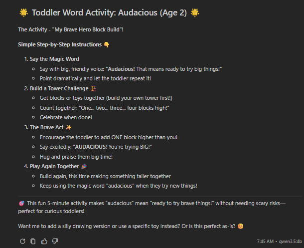

# Local AI in VS Code: RAG, Plugins, Skills, MCP and Agents

This project started in June 2024 as a RAG chatbot for NVIDIA's generative AI contest, using
NVIDIA's cloud models. It has since become a **hands-on demo of running AI models on your own
computer** and connecting them to VS Code and GitHub Copilot: no cloud model, and everything
visible and explainable.

It shows, step by step:
- **RAG:** a chatbot that answers questions from your own documents.
- **A local model served over an API:** TinyLlama and Qwen running on your own CPU or GPU.
- **A VS Code plugin:** a chat panel and an `@tinyllama` chat participant that talk to the local
  model.
- **Copilot Chat with a local model:** Qwen in Ollama, selected in Copilot's model picker.
- **Skills, MCP tools and custom agents:** the building blocks of Copilot's agent harness,
  driven by a model on your own machine.

> **An example for learning, not a product.** Everything here, including the toddler vocabulary
> activity below, demonstrates how the technology works. It isn't designed, tested or secured for
> production use, and it isn't an educational product for children. Answers from small models can
> be wrong or unsuitable: an adult must review anything before it's used with children. See
> [readme-safety.md](readme-safety.md).

## What it can do: one example



*One command in VS Code's Chat view, `/word-of-the-day`, produced this, using **Qwen 3.5 4B
running on this computer's GPU** through Ollama:*
1. **A prompt file** (`.github/prompts/word-of-the-day.prompt.md`) runs the daily routine.
2. **An MCP tool** (the Fetch server) gets today's word, *Audacious*, from
   [Word a Day Kids](https://wordaday.kids/word-of-the-day-for-kids/).
3. **A custom agent** (Idea Generator) brainstorms an activity, one question at a time.
4. **Two instructions files** keep it toddler-friendly and built around the toys at home.

The model's answers are generated locally; the only internet access is the one approved fetch.
See [06_readme-mcp-agents.md](06_readme-mcp-agents.md) for how it's built.

## The demo in brief

The full plan, with learning objectives, timings and a pre-flight checklist, is in
[00_readme-learning-objectives.md](00_readme-learning-objectives.md).

| Step | What you show | What participants learn | Guide |
|---|---|---|---|
| **01 Setup** | The `models/` folder and `model.safetensors`; `hf download` next to `ollama list`; ⚠ a model card. | Training produces weights, inference uses them. What Ollama hides and why it's a stable provider for VS Code. ⚠ A model's supply chain and bias. | [01](01_readme-setup.md) |
| **02 RAG** | Upload lecture slides to the **Envie** app, ask about them, open **Sources**. Resource Monitor filtered by the app's Process ID. | Chunk → embed → store → retrieve → generate; checking answers against sources; proving it's local. | [02](02_readme-rag-user-guide.md) |
| **03 Serving inference** | `src/inference_server.py` as a mini model provider, used by our **TinyLlama Chat** panel. The panel has no way to add context. Stop the server and the answers stop. | How providers serve models over an HTTP API; a model only knows its request; why our server isn't a VS Code model provider. | [03](03_readme-plugin-startup.md) |
| **04 The harness** | `@tinyllama /pirate` in Copilot's Chat view; an attached file cut to fit; Agent mode not available to TinyLlama. | `@` vs `/` vs context; context-window limits; why small models can't use Agent mode. | [04](04_readme-harness.md) |
| **05 Models** | Qwen 3.5 in **Ollama** on the GPU, in Copilot Chat. ⚠ Configure Tools: 118 → 0 → only **read**. In Agent mode, Qwen picks the pirate skill itself (*"Skill Invoked"*). | Version vs. size vs. origin; model, mode and setup for tool use; ⚠ why tools are off by default. | [05](05_readme-models.md) |
| **06 MCP and agents** | `/word-of-the-day`: a prompt file, the **Idea Generator** agent, the **Fetch MCP server** and two instructions files produce a toddler activity for today's word (above). ⚠ Reviewing a public agent file. | The MCP tool-call round trip; instructions files vs. prompt files vs. skills vs. agents; ⚠ injections in public `.md` files. | [06](06_readme-mcp-agents.md) |

**The two safety rules** the presentation builds up to:
1. ⚠ **Disable tools by default**, and enable only what a task needs.
2. ⚠ **Be careful with `.md` files from public collections** (agents, skills, prompt files,
   instructions): the model follows them as instructions. Read the raw file and its `tools:` list
   first.

**Demo tips:**
- **Warm up the models first:** `ollama run qwen3.5:4b "hi"`, and open the Envie app once, so the
  first answer isn't slow.
- **Steps 03–04 use an older commit,** `git switch --detach 378b56c`, where the plugin talks to
  TinyLlama. Run `git switch main` before step 05.
- **Small models are unpredictable.** Rehearse every prompt, and start a **new chat** if one goes
  off track.
- **Zoom-friendly proof:** you can't unplug the internet on a call, so use the Process ID with
  Resource Monitor (step 02), and stop/start the inference server live (step 03).

## Guides

| Guide | What it covers |
|---|---|
| [00_readme-learning-objectives.md](00_readme-learning-objectives.md) | The presentation plan: learning objectives and an 8–10 minute demonstration for each step 01–06, plus the safety thread (tools off by default, care with public `.md` files). Diagram: [docs/learning-steps.drawio](docs/learning-steps.drawio) |
| [01_readme-setup.md](01_readme-setup.md) | Installing everything and downloading the models (Windows), plus the project's history and what changed from the NVIDIA original |
| [02_readme-rag-user-guide.md](02_readme-rag-user-guide.md) | The Envie RAG app: how RAG works step by step, demos and troubleshooting |
| [03_readme-plugin-startup.md](03_readme-plugin-startup.md) | The TinyLlama VS Code plugin's chat panel, and how the plugin works |
| [04_readme-harness.md](04_readme-harness.md) | The Extension Development Host, `@tinyllama` in Copilot's Chat view, and skills |
| [05_readme-models.md](05_readme-models.md) | Replacing TinyLlama with Qwen (Ollama, Foundry Local or this project's server), using the GPU, and Qwen in Copilot Chat |
| [06_readme-mcp-agents.md](06_readme-mcp-agents.md) | MCP tools (Fetch), custom agents (Idea Generator), and turning tools off by default |
| [readme-safety.md](readme-safety.md) | All safety and security points in one place: the two rules, local servers on the network, pickle files, supply chain, pinning, privacy, logs, credentials, and why the examples aren't products. |
| [readme-more-info.md](readme-more-info.md) | Inspecting the hidden context VS Code sends, where `/` commands come from, and the Copilot Harness Builder |
| [readme-model-training.md](readme-model-training.md) | Fine-tuning your own model and publishing it on Hugging Face |
| [readme-dev-container-startup.md](readme-dev-container-startup.md) | Running the RAG app in a dev container / GitHub Codespaces |

**Start here:** [01_readme-setup.md](01_readme-setup.md) to install, then
[02_readme-rag-user-guide.md](02_readme-rag-user-guide.md).

## Project layout

```
rag/
├── src/
│   ├── main.py                  ← Envie, the RAG app (Streamlit)
│   ├── inference_server.py      ← local model behind an OpenAI-compatible API
│   ├── small_model.py           ← terminal-only TinyLlama test
│   └── vscode-extension/        ← the TinyLlama VS Code plugin
├── .github/
│   ├── skills/                  ← pirate, yoda, shakespeare, cowboy, sportscaster
│   ├── agents/                  ← Idea Generator custom agent
│   ├── prompts/                 ← /word-of-the-day: the daily routine as one command
│   └── instructions/            ← toddler-friendly style and our toys, used by /word-of-the-day
├── .vscode/
│   ├── mcp.json                 ← Fetch MCP server
│   ├── tasks.json, launch.json  ← run the plugin in the Extension Development Host
│   └── plugin-test.code-workspace
├── docs/images/                 ← screenshots for this readme
├── .devcontainer/               ← dev container / Codespaces setup
├── models/                      ← downloaded models (not in git)
├── uploaded_docs/, vectorstore/ ← your documents and their search index (not in git)
├── requirements.txt
└── 0X_readme-*.md, readme-*.md  ← the guides
```

---

## Background: the original project and sources

This project began as an entry for the NVIDIA + LangChain generative AI contest (submissions due
June 17, 2024), which asked for an app using NVIDIA technologies and LangChain. The starting
point was NVIDIA's "5 minute RAG" example. [01_readme-setup.md](01_readme-setup.md) describes
everything that changed since.

- [How does RAG work in 60 seconds](https://youtube.com/shorts/xS55duPS-Pw?si=VjVI12iVxdDdy5Xc)
- [What is LangChain?](https://youtu.be/1bUy-1hGZpI?si=WMVdGpjGJWcwUeBv)
- [Tips for Building a RAG Pipeline with NVIDIA AI LangChain AI Endpoints](https://developer.nvidia.com/blog/tips-for-building-a-rag-pipeline-with-nvidia-ai-langchain-ai-endpoints/)
- https://github.com/NVIDIA/GenerativeAIExamples
- https://docs.nvidia.com/nemo/guardrails/user_guides/llm/nvidia_ai_endpoints/README.html

### [Build a Retrieval-Augmented Generation Chatbot in 5 Minutes](https://youtu.be/N_OOfkEWcOk?si=PO--ZS2-ro-H8fYG)
The original code: [5_mins_rag_no_gpu/main.py](https://github.com/NVIDIA/GenerativeAIExamples/blob/main/examples/5_mins_rag_no_gpu/main.py).

### [Large Language Models: Application through Production](https://learning.edx.org/course/course-v1:Databricks+LLM101x+2T2023/home)
The Databricks course on edX, with an explainer of how RAG databases work. Its notebooks only run
in Databricks.
- [2.7.1 Notebook Demo Part 1](https://learning.edx.org/course/course-v1:Databricks+LLM101x+2T2023/block-v1:Databricks+LLM101x+2T2023+type@sequential+block@d230efabe642484cb7f8cf9b23f8cad4/block-v1:Databricks+LLM101x+2T2023+type@vertical+block@098cf1bc67924d6dbac16d6ff3fc5cc9),
  with [the notebook's source code](https://github.com/sprintup/large-language-models/blob/08a6ae43bce7d8ad138e7bf1890216d0273aa689/LLM%2002%20-%20Embeddings%2C%20Vector%20Databases%2C%20and%20Search/LLM%2002%20-%20Embeddings%2C%20Vector%20Databases%2C%20and%20Search.py#L14C470-L14C623)

### Misc resources
- [Ollama: build a chatbot with LangChain and Ollama, deploy on Docker](https://abvijaykumar.medium.com/ollama-build-a-chatbot-with-langchain-ollama-deploy-on-docker-5dfcfd140363)
- [What is a Vector Database?](https://www.youtube.com/watch?v=t9IDoenf-lo)
- [LangChain docs](https://python.langchain.com/v0.2/docs/introduction/)
- [LM Studio](https://lmstudio.ai/)
- [Hugging Face](https://huggingface.co/)
- [Databricks](https://www.databricks.com/)
- [Using `generate_events_async` and Streaming](https://github.com/NVIDIA/NeMo-Guardrails/blob/develop/examples/notebooks/generate_events_and_streaming.ipynb)
- NVIDIA LLM Developer Day videos:
  - [The Fast Path to Developing with LLMs](https://event.on24.com/wcc/r/4371300/9C96C2D84F0E9BB46E757F807129A8C3)
  - [Tailoring LLMs to Your Use Case](https://event.on24.com/wcc/r/4371524/02081723A09362868B14957B07C4F01C)
  - [Large Language Models and Generative AI for Life Sciences](https://event.on24.com/wcc/r/4390803/017BA6B34D53EB796D3D3BFE36D3FCFB)
  - [Running Your Own LLM](https://event.on24.com/wcc/r/4371549/0AF4CBAA6515D4EC0FFEE49E90C3B2C7)
  - [Reinventing the Complete Cybersecurity Stack With AI Language Models](https://event.on24.com/wcc/r/4390810/FDC5E74A0029E3B32C3543246BBA7356)
  - [Technical Ask-the-Experts](https://event.on24.com/wcc/r/4371579/02DC8E8C6C6D7B0BD739E97DAE97BAC0)
